<p align="center">
  <a href="https://github.com/Nerion-1337/train_rl_agent/actions/workflows/ci.yml"></a>
  
  
  
  
  
  
  
  
  
  
  
  
  
  
  
  
  
</p>

# Eagle-1 — Pilote automatique par apprentissage par renforcement

Projet d'école (AstroDynamics, fictif) : trois exercices pour apprendre les bases de l'**apprentissage par
renforcement**, puis le **pilote automatique du module lunaire Eagle-1** sur `LunarLander-v3`, livré avec une
API, un GUI, un tableau de bord, une vidéo et un rapport.

<p align="center">
  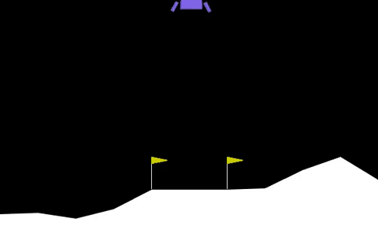
</p>

| Objectif du cahier des charges | Résultat |
|---|---|
| Récompense moyenne **≥ 200 sur 100 épisodes**, stable | **274,9 ± 19,1** sur 100 épisodes inédits · pire épisode 232,7 · **100 %** d'atterrissages ≥ 200 |
| Reproductibilité | 3 graines : 280,5 · 282,3 · 278,4 (écart entre graines : 1,6) |
| Précision / carburant | |x| final moyen 0,025 (zone cible ±0,2) · 100 % des poses dans la zone · ≈ 32 unités de carburant par atterrissage |

Tout s'exécute dans **Docker** ; les dépendances et le venv sont gérés par **uv** dans le container.

---

## Sommaire

1. [Résultats](#résultats) · 2. [Livrables et cahier des charges](#livrables-et-cahier-des-charges) ·
3. [Organisation](#organisation-du-dépôt) · 4. [Architecture](#architecture) · 5. [Exécution](#exécution) ·
6. [Entraînement](#entraînement-et-optimisation) · 7. [API](#api) · 8. [Exercices](#exercices) · 9. [CI](#intégration-continue-github-actions) · 10. [graphify](#graphe-de-connaissances-du-code-graphify)

---

## Résultats

| Étape | Environnement | Ce qu'on apprend | Résultat |
|---|---|---|---|
| [Exercice 1](notebooks/exercice_1_cartpole_bases.ipynb) | CartPole-v1 | Espaces `Box` / `Discrete`, boucle `reset → step`, agent aléatoire | 22,7 ± 10,5 / 500 |
| [Exercice 2](notebooks/exercice_2_qlearning_frozenlake.ipynb) | FrozenLake-v1 | Q-learning : Q-table, ε-greedy, équation de Bellman | 66 % de réussite |
| [Exercice 3](notebooks/exercice_3_dqn_cartpole.ipynb) | CartPole-v1 | DQN manuel PyTorch puis Stable-Baselines3 | SB3 ajusté **500 ± 0** |
| [**Mission**](notebooks/mission_eagle1_lunarlander.ipynb) | LunarLander-v3 | Exploration, choix d'algorithme, optimisation, évaluation, déploiement | **274,9 ± 19,1** |

**Démarche de la mission** (détaillée dans le notebook et le [rapport PDF](docs/rapport_eagle1.pdf)) :

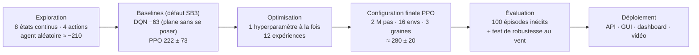

| Expérience (100 épisodes d'évaluation) | Moyenne ± écart-type | Avec vent |
|---|---|---|
| `dqn_baseline` (défaut) | −63,0 ± 55,8 | 30,8 |
| `dqn_tuned` (combinaison RL Zoo) | 267,7 ± 38,2 | 75,8 |
| `ppo_baseline` (défaut) | 222,2 ± 72,6 | 139,4 |
| `ppo_lr_1e-3` (meilleur changement isolé) | 280,5 ± 18,2 | 195,9 |
| **`ppo_final_s0`** (production) | **280,5 ± 19,3** | 122,6 |
| `ppo_final_wind` (entraîné avec vent) | 201,0 ± 61,4 | 125,1 |

**Leçons principales** : DQN par défaut échoue en apprenant à *planer* pour éviter le crash ; PPO est plus
stable et moins dépendant des réglages ; les hyperparamètres comptent autant que l'algorithme ; un modèle
excellent en conditions nominales n'est pas robuste par défaut à une physique jamais vue (vent) : les variantes
entraînées moins longtemps (`ent_coef`, `gae_lambda`, `lr`) y résistent mieux, et entraîner avec du vent sur le
même budget n'a pas suffi — c'est la principale piste d'amélioration.

---

## Livrables et cahier des charges

| Livrable demandé | Fichier | Statut |
|---|---|---|
| Notebook (exploration, choix d'algorithme, entraînement, optimisation, évaluation) | [notebooks/mission_eagle1_lunarlander.ipynb](notebooks/mission_eagle1_lunarlander.ipynb) | ✅ |
| Vidéo 20-30 s d'une performance réussie (`RecordVideo`) | [media/eagle1_atterrissage.mp4](media/eagle1_atterrissage.mp4) (25 s, 6 atterrissages) | ✅ |
| API pour interagir avec le modèle (`/play` : état → action) | [eagle1/api.py](eagle1/api.py) (FastAPI) | ✅ |
| Interface graphique : visualisation d'une partie | [eagle1/gui.py](eagle1/gui.py) (Streamlit) | ✅ |
| Tableau de bord : récompenses, moyenne, écart-type, décisions selon la circonstance | [eagle1/dashboard.py](eagle1/dashboard.py) (Streamlit) | ✅ |
| Notebooks des exercices 1 à 3 | [notebooks/](notebooks/) | ✅ |
| Rapport explicatif (démarche, interprétation, notions essentielles) | [docs/rapport_eagle1.pdf](docs/rapport_eagle1.pdf) | ✅ |

| Exigence | Où c'est vérifié |
|---|---|
| Moyenne ≥ 200 sur 100 épisodes consécutifs, écart-type faible | notebook §6, test `test_model_reaches_target` |
| Baseline par défaut évaluée sur ≥ 50 épisodes | notebook §3 (100 épisodes) |
| PPO / DQN selon l'espace d'actions, choix argumenté | notebook §2 |
| Un hyperparamètre à la fois, documenté, TensorBoard | notebook §4, `logs/mission`, [eagle1/train.py](eagle1/train.py) |
| Généralisation (pas de surapprentissage) | graines jamais vues + test avec vent (notebook §6) |
| Toute la logique RL côté API | le GUI et le dashboard n'appellent que l'API HTTP |
| Prototype local sans serveur externe | `docker compose up -d`, tout tourne en local |
| Code lisible, modulaire, commenté | package `eagle1/`, tests, CI |

> Le brief cite `LunarLander-v2`, retiré de Gymnasium 1.x : on utilise `LunarLander-v3` (même tâche, bugs corrigés).

**Zip de dépôt** au format demandé (`Nom_Prenom_n°_livrable_mmaaaa`) :

```powershell
docker compose exec jupyter uv run --no-sync python -m eagle1.package --nom Nom --prenom Prenom --date 112026
```

→ `dist/Eagle1_Pilote_Automatique_Nom_Prenom.zip` (6 livrables + le code source complet en n° 7).

---

## Organisation du dépôt

```
train_rl_agent/
├── eagle1/                       # Package de la mission
│   ├── core.py                   # Environnement, chargement du modèle, épisodes instrumentés, stockage SQLite
│   ├── train.py                  # Expériences (baselines, optimisation, final), évaluation, promotion
│   ├── video.py                  # Vidéo .mp4 avec RecordVideo
│   ├── api.py                    # API FastAPI — toute la logique RL
│   ├── gui.py                    # GUI Streamlit — visualisation d'une partie
│   ├── dashboard.py              # Tableau de bord Streamlit — suivi des performances
│   └── package.py                # Zip de dépôt des livrables
├── notebooks/                    # Exercices 1-3 + notebook de la mission
│   └── rl_viz.py                 # GIF d'épisodes + graphiques 3D Plotly (exercices)
├── tests/test_api.py             # Tests de l'API (dont le critère ≥ 200)
├── docs/                         # Rapport PDF + son générateur
├── models/                       # eagle1_best.zip (production) + experiments/*.zip
├── results/                      # experiments/*.json, curves/*.npz, final_evaluation.json, eagle1.db
├── media/                        # Vidéo, GIF, graphiques 3D
├── contexte/                     # Énoncés
├── .github/workflows/ci.yml      # CI : lock uv, tests, exécution des notebooks
├── Dockerfile · docker-compose.yml · pyproject.toml · uv.lock · .env
└── logs/                         # TensorBoard (généré, ignoré par git)
```

---

## Architecture

### Services Docker

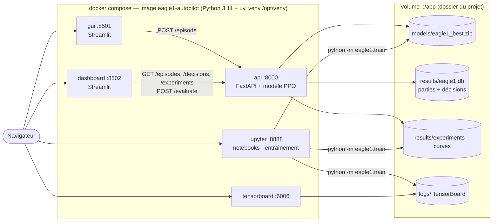

Le GUI et le tableau de bord ne chargent **aucun modèle** : toute la logique RL (décisions, parties, évaluation)
est dans l'API. Tous les services ont `restart: unless-stopped`.

### Diagramme UML du package `eagle1`

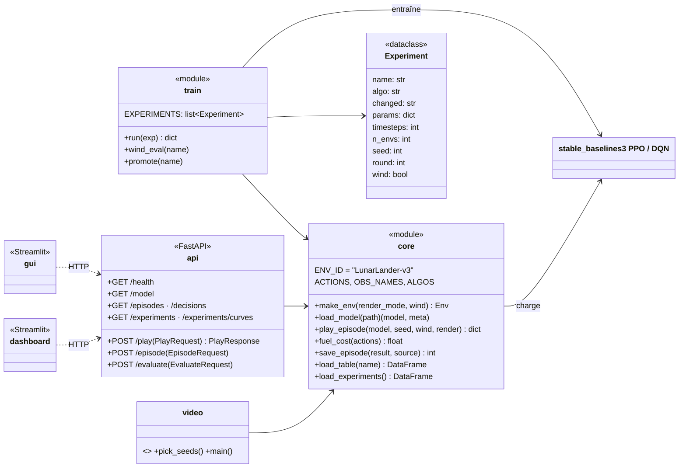

### Une partie jouée depuis le GUI

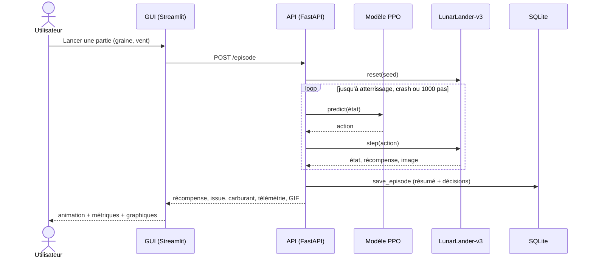

---

## Exécution

**Prérequis** : Docker Desktop (ou Docker Engine + Compose v2). Rien d'autre à installer sur l'hôte.

```powershell
docker compose build
```

```powershell
docker compose up -d
```

| Service | URL |
|---|---|
| GUI — visualiser une partie | <http://localhost:8501> |
| Tableau de bord | <http://localhost:8502> |
| API (documentation interactive) | <http://localhost:8000/docs> |
| JupyterLab (token `eagle1`, défini dans `.env`) | <http://localhost:8888/lab?token=eagle1> |
| TensorBoard | <http://localhost:6006> |

Les services tournent en permanence (`restart: unless-stopped`). Pour qu'ils reviennent après un redémarrage du
PC, activer *Start Docker Desktop when you sign in* dans Docker Desktop. Arrêt : `docker compose down`.

**Tests** :

```powershell
docker compose exec jupyter uv run --no-sync pytest -q
```

**Exécuter tous les notebooks sans interface** (sorties enregistrées dans les notebooks) :

```powershell
docker compose run --rm --no-deps jupyter uv run --no-sync jupyter nbconvert --to notebook --execute --inplace --ExecutePreprocessor.timeout=1800 notebooks/exercice_1_cartpole_bases.ipynb notebooks/exercice_2_qlearning_frozenlake.ipynb notebooks/exercice_3_dqn_cartpole.ipynb notebooks/mission_eagle1_lunarlander.ipynb
```

**Régénérer la vidéo et le rapport** :

```powershell
docker compose exec jupyter uv run --no-sync python -m eagle1.video
```

```powershell
docker compose exec jupyter uv run --no-sync python docs/build_report.py
```

---

## Entraînement et optimisation

Les 16 expériences sont déclarées dans [eagle1/train.py](eagle1/train.py) ; chacune ne change **qu'un
hyperparamètre** par rapport à sa baseline (sauf les configurations finales). Elles tournent en parallèle
(≈ 47 min pour les étapes 1-2 sur 16 cœurs) :

```powershell
docker compose exec jupyter uv run --no-sync python -m eagle1.train --list
```

```powershell
docker compose exec jupyter uv run --no-sync python -m eagle1.train --workers 15
```

```powershell
docker compose exec jupyter uv run --no-sync python -m eagle1.train --wind-eval --workers 15
```

```powershell
docker compose exec jupyter uv run --no-sync python -m eagle1.train --promote ppo_final_s0
```

Pour chaque expérience : journaux TensorBoard (`logs/mission`), courbe d'évaluation (`results/curves/<nom>`),
modèle (`models/experiments/<nom>.zip`) et résultats sur 100 épisodes aux graines jamais vues, en conditions
nominales et avec vent (`results/experiments/<nom>.json`).

---

## API

| Endpoint | Rôle |
|---|---|
| `GET /health` | état du service et du modèle |
| `GET /model` | modèle en production et ses performances |
| `POST /play` | `{"state": [8 réels]}` → action, nom de l'action, probabilités de chaque action |
| `POST /episode` | joue une partie : résumé, télémétrie pas à pas, animation GIF (base64) |
| `POST /evaluate` | joue N parties, renvoie moyenne, écart-type, taux de réussite, issues |
| `GET /episodes`, `GET /decisions` | historique des parties et des décisions (tableau de bord) |
| `GET /experiments`, `GET /experiments/curves` | résultats et courbes d'entraînement |

```powershell
curl.exe -X POST http://localhost:8000/play -H "Content-Type: application/json" -d '{\"state\": [0, 1.4, 0, -0.5, 0, 0, 0, 0]}'
```

---

## Exercices

Chaque notebook d'exercice se termine par une section **Aperçu visuel** ([notebooks/rl_viz.py](notebooks/rl_viz.py)) :
animations GIF et graphiques **3D interactifs** Plotly (à faire pivoter dans JupyterLab ; fichiers `media/*.html`).

| CartPole — agent aléatoire | FrozenLake — Q-learning | CartPole — DQN entraîné |
|:---:|:---:|:---:|
| 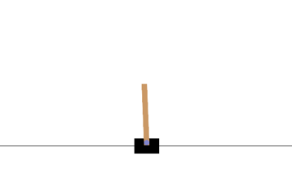 | 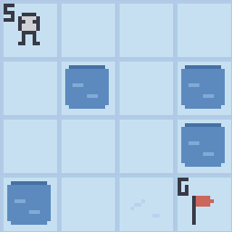 | 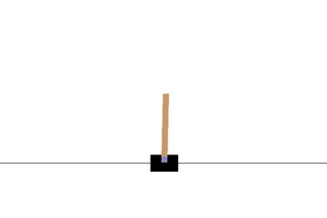 |
| Le bâton tombe en ~20 pas | L'agent contourne les trous | 500 pas sans tomber |

<details>
<summary>Cycle du RL et UML de l'exercice 3 (DQN)</summary>

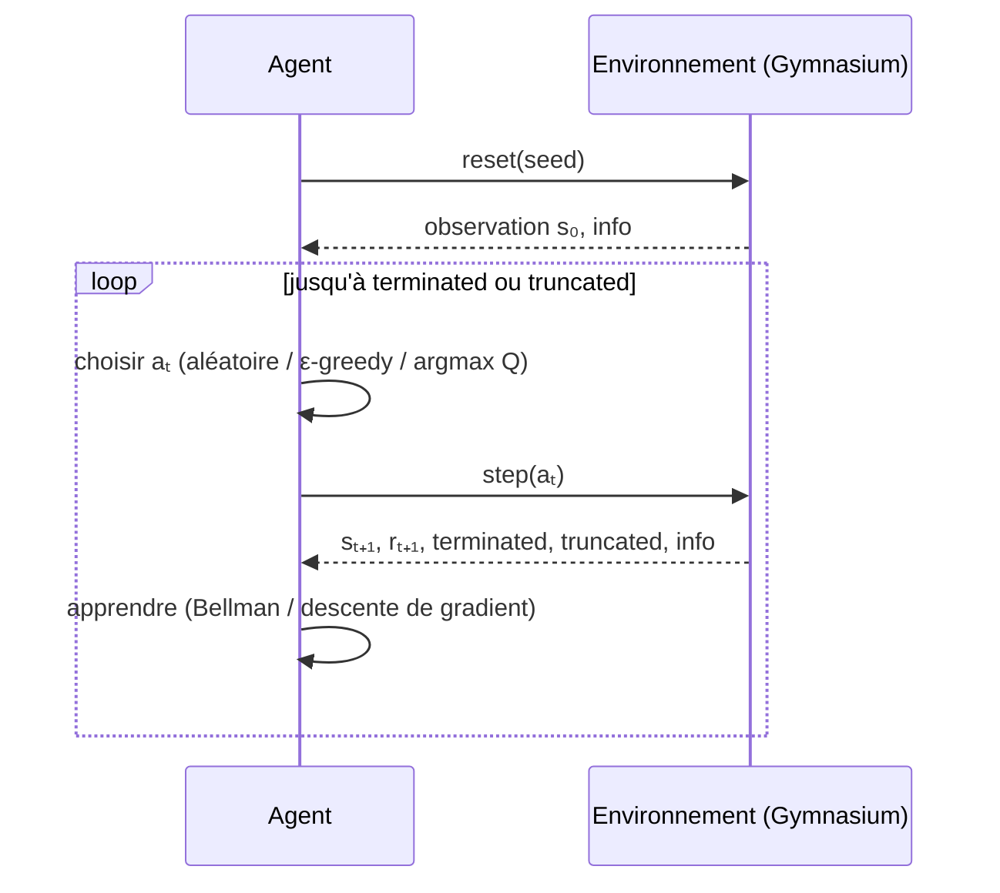

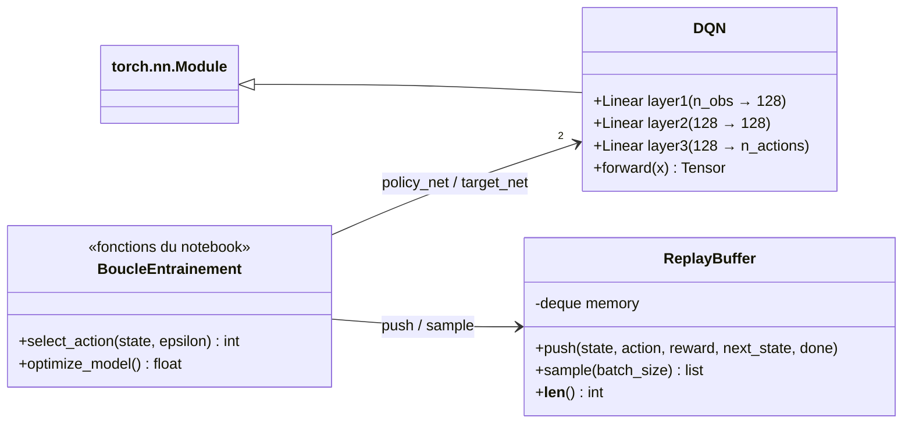

</details>

---

## Intégration continue (GitHub Actions)

[`.github/workflows/ci.yml`](.github/workflows/ci.yml) — à chaque push sur `main`, pull request ou à la main :

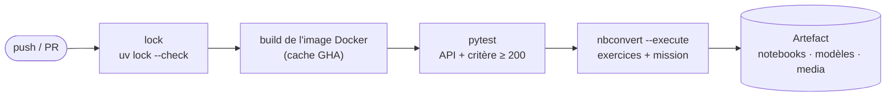

---

## Graphe de connaissances du code (graphify)

[graphify](https://github.com/safishamsi/graphify) construit en local (AST tree-sitter) un graphe des modules,
classes et fonctions. Installation hors container (`uv tool install graphifyy`), puis :

```powershell
docker compose run --rm --no-deps jupyter uv run --no-sync jupyter nbconvert --to script 'notebooks/*.ipynb' --output-dir build/graph_src
```

```powershell
graphify update .
```

Sorties : `graphify-out/graph.html` (visualisation interactive), `graph.json`, `GRAPH_REPORT.md`.
