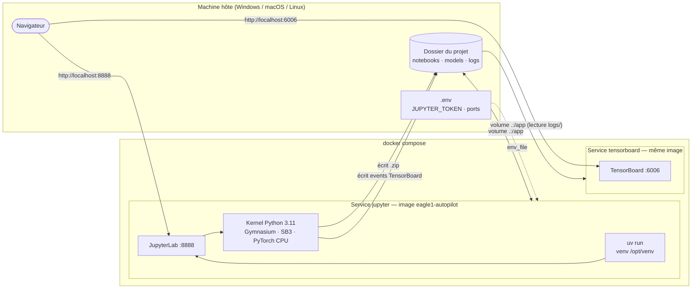
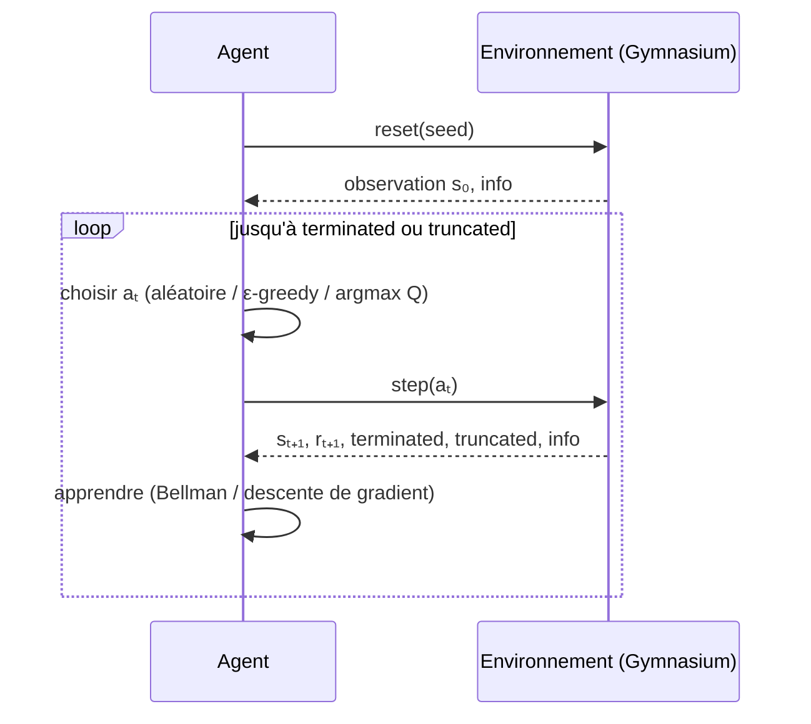
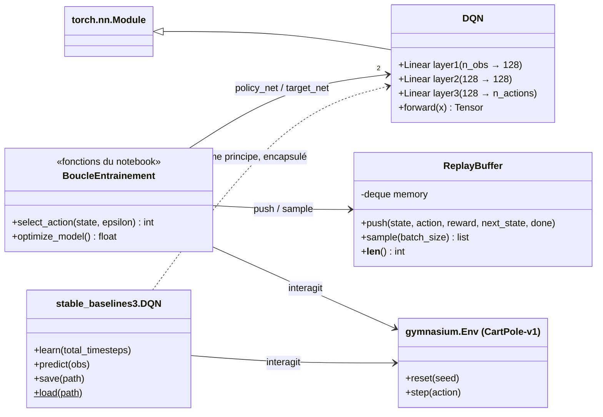
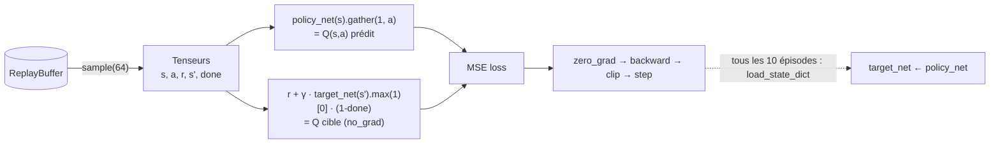
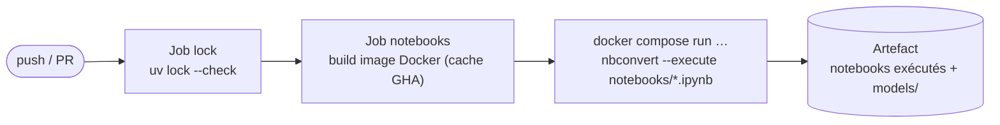

<p align="center">
  
  
  
  
  
  
  
  
  
  
  
</p>

# Eagle-1 — Pilote automatique par apprentissage par renforcement

Projet d'école (AstroDynamics, fictif) : apprendre les bases de l'**apprentissage par renforcement** à travers
trois exercices guidés, puis développer le pilote automatique du module lunaire **Eagle-1** sur
`LunarLander-v3` (objectif : récompense moyenne **≥ 200** sur 100 épisodes), avec API, GUI et tableau de bord.

> **État d'avancement** : ✅ exercices 1 à 3 · ⏳ mission LunarLander (notebook, vidéo, API, GUI, dashboard)

Tout s'exécute dans un **container Docker** ; les dépendances et le venv sont gérés par **uv** à l'intérieur du container.

---

## Ce que fait le projet

| Notebook | Environnement | Ce qu'on apprend | Résultat |
|---|---|---|---|
| [exercice_1_cartpole_bases.ipynb](notebooks/exercice_1_cartpole_bases.ipynb) | CartPole-v1 | Espaces d'observation (`Box`) / d'action (`Discrete`), boucle `reset → step`, agent aléatoire sur 10 épisodes | Agent aléatoire : **26,5 ± 22,5** sur 10 épisodes (max 500) |
| [exercice_2_qlearning_frozenlake.ipynb](notebooks/exercice_2_qlearning_frozenlake.ipynb) | FrozenLake-v1 (glissant) | Q-learning tabulaire : Q-table 16×4, epsilon-greedy, équation de Bellman, évaluation sans exploration | **66 %** de réussite sur 100 épisodes d'évaluation |
| [exercice_3_dqn_cartpole.ipynb](notebooks/exercice_3_dqn_cartpole.ipynb) | CartPole-v1 | DQN manuel PyTorch (réseau, replay buffer, target network) puis DQN Stable-Baselines3 (défaut vs ajusté), sauvegarde `.zip` | DQN manuel ≈ 285 · SB3 défaut (25k pas) 22,5 · SB3 ajusté (50k pas) **500 ± 0** → `models/dqn_cartpole.zip` |
| *mission (à venir)* | LunarLander-v3 | Baseline, optimisation d'hyperparamètres, vidéo, API FastAPI, GUI, dashboard | — |

---

## Organisation du dépôt

```
train_rl_agent/
├── .github/workflows/ci.yml  # CI GitHub Actions : lock uv + exécution des notebooks dans Docker
├── contexte/                 # Énoncés : exercices, mission, brief PDF, livrables
├── notebooks/                # Exercices 1-3 (+ notebook de la mission finale)
│   ├── exercice_1_cartpole_bases.ipynb
│   ├── exercice_2_qlearning_frozenlake.ipynb
│   └── exercice_3_dqn_cartpole.ipynb
├── models/                   # Modèles entraînés (.zip SB3) — ex. dqn_cartpole.zip
├── logs/                     # Logs TensorBoard (générés, ignorés par git)
├── build/graph_src/          # Code des notebooks exporté en .py + graphe graphify (généré)
├── pyproject.toml            # Dépendances (uv) — torch en version CPU
├── uv.lock                   # Versions figées, reproductibles
├── Dockerfile                # python:3.11-slim + uv, venv dans /opt/venv
├── docker-compose.yml        # Services jupyter (8888) et tensorboard (6006)
└── .env                      # Token Jupyter et ports (valeurs fictives)
```

---

## Architecture d'exécution



Le venv est placé **hors** du dossier monté (`/opt/venv`) : le code de l'hôte est visible en direct dans le
container sans écraser les dépendances installées à la construction de l'image.

---

## Le cycle de l'apprentissage par renforcement



---

## Diagramme UML — exercice 3 (DQN)



Fonctionnement de `optimize_model()` :



---

## Exécution

**Prérequis** : Docker Desktop (ou Docker Engine + Compose v2). Rien d'autre à installer sur l'hôte.

1. Construire l'image (installe le venv uv à partir de `uv.lock`) :

```powershell
docker compose build
```

2. Lancer JupyterLab et TensorBoard :

```powershell
docker compose up
```

- JupyterLab : <http://localhost:8888/lab?token=eagle1> (token défini dans `.env`)
- TensorBoard : <http://localhost:6006>

3. Ouvrir les notebooks de `notebooks/` et exécuter les cellules dans l'ordre.

**Exécuter tous les exercices sans interface** (les sorties sont enregistrées dans les notebooks) :

```powershell
docker compose run --rm --no-deps jupyter uv run --no-sync jupyter nbconvert --to notebook --execute --inplace --ExecutePreprocessor.timeout=1800 notebooks/exercice_1_cartpole_bases.ipynb notebooks/exercice_2_qlearning_frozenlake.ipynb notebooks/exercice_3_dqn_cartpole.ipynb
```

**Ajouter une dépendance** (le lock est régénéré, puis l'image reconstruite) :

```powershell
docker compose run --rm --no-deps jupyter uv add <paquet>
```

```powershell
docker compose build
```

Arrêter : `Ctrl+C` puis `docker compose down`.

---

## Intégration continue (GitHub Actions)

Le workflow [`.github/workflows/ci.yml`](.github/workflows/ci.yml) s'exécute à chaque push sur `main`,
à chaque pull request, ou à la main (*Run workflow*) :



- **lock** : échoue si `uv.lock` n'est plus en phase avec `pyproject.toml`.
- **notebooks** : construit la même image que `docker compose`, exécute tous les notebooks dans le container
  (échec si une cellule lève une exception) et publie les notebooks exécutés et les modèles en artefact.

---

## Graphe de connaissances du code (graphify)

[graphify](https://github.com/safishamsi/graphify) analyse le code (AST tree-sitter, en local) et produit un
graphe navigable des fonctions, classes et dépendances. Installation (hors container, outil de dev) :

```powershell
uv tool install graphifyy
```

graphify ne lit pas les `.ipynb` : on exporte d'abord le code des notebooks en `.py`, puis on construit le graphe :

```powershell
docker compose run --rm --no-deps jupyter uv run --no-sync jupyter nbconvert --to script 'notebooks/*.ipynb' --output-dir build/graph_src
```

```powershell
graphify update build/graph_src
```

Sorties dans `build/graph_src/graphify-out/` : `graph.html` (visualisation interactive), `graph.json`, `GRAPH_REPORT.md`.
Les nœuds centraux actuels sont `ReplayBuffer` et `DQN` (exercice 3) ; le graphe s'enrichira avec le code
de la mission (API, GUI, dashboard), qui sera écrit en `.py`.
